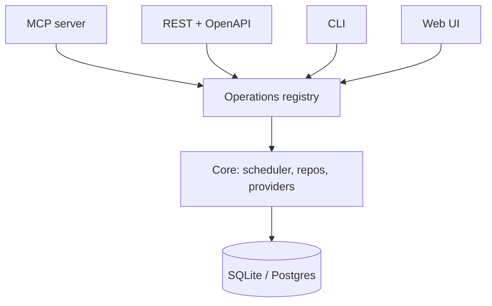

## Process model

Turntable is one process. `turntable serve` opens the database, applies migrations, then starts an HTTP server. Depending on `--roles`, the same process also runs the poller, workers (scheduler, log pipeline, provider supervisor) and the realtime feed. Signing and publishing run in a separate release process, see [Release lane](/release-lane). Sandboxes are separate, disposable environments created by providers, one per job.

## Operations registry

Every capability is defined once in an operations registry. The MCP server, REST API, CLI and UI all sit on that single layer, so no surface has capabilities the others lack. See [Agent interface](/agent-interface).

## Storage

SQLite is the default and lives at `<data-dir>/turntable.db`. Postgres is not built yet. Access goes through Drizzle ORM, and the schema uses portable column types (ULID text ids, epoch-ms integers, text plus CHECK for enums, no arrays) so the Postgres port stays mechanical.

## Embedded migrations

The compiled binary must work from an empty directory, so it never reads assets from disk. drizzle-kit generates SQL migrations, then `packages/core/scripts/gen-migrations.ts` inlines them into `src/db/migrations.generated.ts`. A small dialect-agnostic runner applies them on boot. CI fails if the embedded module is stale.

## Tenancy model

One Turntable instance serves many orgs. An org is the tenant. Isolation is enforced in the data layer, not by convention.

### Entities

- **Org**: the tenant boundary. Has a unique slug.
- **Project**: belongs to one org, slug unique per org. Runs, jobs and logs hang off a project.
- **Project repo**: binds a project to a forge repo (today: GitHub, optionally with an installation id). A `(forge, owner, repo)` triple belongs to exactly one project instance-wide, so webhook routing is unambiguous. Owner and repo are stored lowercase (forges treat them case-insensitively). `forge_repo_id` holds the forge's stable numeric id, unique per forge when set. Webhook routing should prefer it when present, because names change on rename and transfer.
- **User**: global identity. A person can belong to several orgs.
- **Org member**: links a user to an org with a role: `owner`, `admin`, `member` or `viewer`.
- **Local tenant**: `turntable run` uses a built-in org `local` with project `local`, created idempotently by `ensureLocalTenant`.

### Runs, jobs, attempts, logs

- A **run** is one workflow execution for a project. A **job** is one job of that run. A **job attempt** is one try of a job in one sandbox. **Log chunks** are byte-addressed per attempt, so readers resume by offset.
- Job states: `queued`, `running`, `success`, `failure`, `infra_error`, `awaiting_approval`, `cancelled`.
  - `failure` is the job's own non-zero exit.
  - `infra_error` means no trustworthy result: sandbox create failed, provider error, exit code unrecoverable, infra timeout.
  - `success`, `failure` and `cancelled` are terminal. `infra_error` can return to `queued` for a retry, which creates a new attempt.

### Infra retries

A transient infrastructure failure is retried once. An `infra_error` carries a kind from a closed set. The kind is stored on the attempt (`job_attempts.infra_kind`) and the reason text is unchanged.

| Kind | Cause | Retried |
| --- | --- | --- |
| `docker_daemon_unavailable` | `docker info` failed in a Docker-class sandbox | yes, every class |
| `service_unhealthy` | a job's service container did not report healthy within act's 5 minute limit, so no step ran | no (usually the service's own config) |
| `sandbox_create_failed` | the provider could not create the sandbox | yes, every class |
| `sandbox_lost` | the sandbox or the act process in it vanished, possibly mid-run | only `trusted_pr` and `untrusted_pr` jobs |
| `image_pull_rate_limited` | reserved, nothing produces it yet (preflight) | yes, every class |
| `checkout_fetch_failed` | the control plane could not fetch the sources (full history or submodules) because of a network error, before any sandbox exists | yes, every class. While the network is degraded it is requeued without using the retry. This is a change: on a healthy network every such fetch error that is not an auth or tree-scan error now gets the one retry, deterministic ones included |
| `checkout_auth_failed` | GitHub refused the checkout (HTTP 401 or 403, or 404 to a request with a token) | no |
| `tree_scan` | the strict scan of the checkout's tarball refused it, with the rule in the reason and the job log | no |
| `fetch_limit` | the checkout ran over its pack, unpacked, tarball or memory budget, with the limit, its value and the setting that raises it in the reason and the job log | no |
| `other` | anything else | no |

Each kind has a `beforeSteps` field in `INFRA_KINDS`. A kind that happens before any job step runs is retried for every trust class. A kind that can happen mid-run (`sandbox_lost`) may follow steps with side effects, such as a deploy or a publish, so it is retried only for pull request jobs. A `protected` or `release` job ends `infra_error` with the reason, with no retry. A job whose class is not yet recorded counts as not a pull request.

- **One retry per job.** The first transient failure ends its attempt `infra_error` and queues a new attempt for the same job, after a fixed 10 s backoff. The failed sandbox is already released, so the retry gets a fresh one. The new attempt goes through the same claim and run steps as any attempt, so every refusal and size or tenant-class check applies again. It sets no rerun reason, so it uses none of the commit's reruns.
- **Separate from the drain requeue.** The one requeue of an attempt cut by a drain (`controller_lost`) has its own limit. A job can have both. A manual rerun starts a fresh retry budget.
- **The drain-cut rule.** An attempt a drain timeout cut, whose sandbox is gone at the next boot, is requeued once by the same rule: for a `trusted_pr` or `untrusted_pr` job, or for any class when no step had started (no `attempt_steps` row for the attempt). A `protected` or `release` job cut after a step started, or with no recorded class, is not requeued: it ends `infra_error` with the reason `cut by a drain after steps started; not retried for a protected or release job: rerun it by hand`, and the run's events and the audit log record `attempt.drain_cut_not_retried` with the job, org and project, so a deploy note can list it as needing a manual rerun. A step the runner started but had not yet recorded is not seen, so the evidence can lag by one write.
- **Never retried:** refusals, test failures, cancels, the job's own timeout, and kinds not marked transient.
- **Visible.** The first attempt keeps its log and reason. The job's check is updated in place and says it is on its retry. The run's events and the audit log record `attempt.infra_retry` with the kind. If the retry also fails with an infra error, that attempt's reason carries both.

### Isolation guarantees

1. Every tenant-owned table has an `org_id` column. A test fails if a new table lacks one and is not on the explicit allowlist (`instance`, `orgs`, `users`).
2. All access goes through `packages/core/src/db/repos`. Each function takes a `Scope` (`{ orgId, projectId? }`) and always filters by it. A lookup by id in another org returns nothing, and writes affect nothing.
3. A source-guard test fails if code outside the repos module references a tenant table.
4. Composite foreign keys such as `(run_id, org_id, project_id)` make the database reject a child row whose org or project differs from its parent's, even if application code is wrong. Jobs, attempts and log chunks all carry `project_id`, so a project-narrowed scope cannot reach a sibling project's data in the same org.
5. Portable column types keep a Postgres port mechanical.

### Scope of the guarantee

These rules cover the database layer. The same org boundary applies to secrets, caches, artifacts and sandboxes: none of them is shared across orgs. [Tenant isolation](/tenant-isolation) lists the tests and which keys are per org. Webhook routing (`resolveRepoScope`) is the one deliberately unscoped lookup, because the caller has no tenant yet. When a binding has an `installation_id`, the incoming installation must match it, so a same-named repo under another installation cannot route into the bound org.
